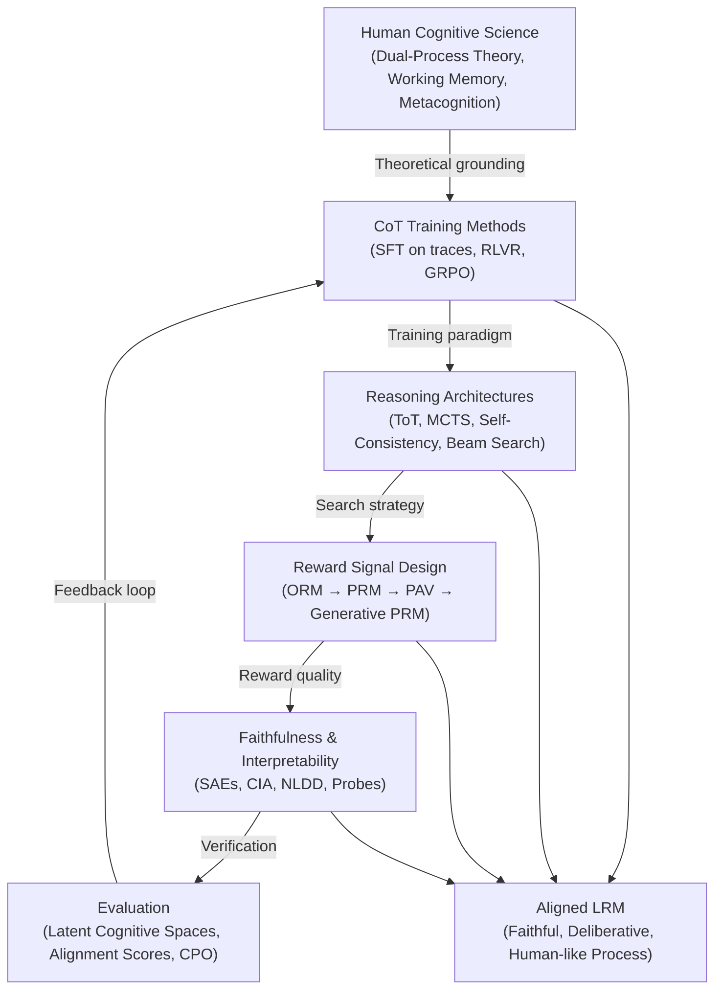

# Literature Review: Aligning LLM Reasoning with Human Cognitive Processes via Chain-of-Thought

> [!NOTE]
> This review covers the intersection of **LLM alignment**, **Chain-of-Thought (CoT) training**, and **human cognitive science** — with particular focus on reinforcement learning approaches (GRPO, RLVR) that teach models to reason in a human-like process, not just produce human-like outputs.

---

## 1. The Core Question

Can we teach a Large Language Model not just *what* to say, but *how to think*?

This question sits at the frontier of AI research. Classical alignment (RLHF, SFT) focused on matching surface-level human preferences — making models helpful, harmless, and honest at the **output** level. The modern paradigm asks something deeper: can a model's intermediate **reasoning process** be aligned with how humans actually solve problems?

---

## 2. Theoretical Grounding: Dual-Process Theory

The dominant cognitive science framework imported into this field is Daniel Kahneman's **Dual-Process Theory**:

| System | Properties | LLM Analogy |
|--------|-----------|-------------|
| **System 1** | Fast, automatic, intuitive, pattern-matched | Standard next-token prediction |
| **System 2** | Slow, deliberate, effortful, analytical | Chain-of-Thought reasoning |

Standard LLM generation is fundamentally a System 1 mechanism — the transformer forward pass produces the statistically most likely continuation token by token, with no explicit deliberation. CoT reasoning is the primary technical tool for simulating System 2 cognitive engagement.

> [!IMPORTANT]
> This is not just a metaphor. Empirical studies placing humans and LLMs in shared "cognitive spaces" (defined by latent variables like memory decay, sampling strategy, and choice bias) demonstrate that **CoT shifts LLM behavior measurably closer to human System 2 profiles** on probabilistic reasoning benchmarks.

---

## 3. Historical Trajectory

### 3.1 Early CoT: Prompting as a Bridge (2022–2023)
- **Wei et al. (2022)** introduced chain-of-thought prompting — the discovery that simply including "Let's think step by step" dramatically improved LLM performance on multi-step reasoning tasks.
- The original framing was engineering, not cognitive science. But it immediately suggested a deeper analogy: the model was being pushed to externalize working memory operations.

### 3.2 From Prompt Engineering to Cognitive Architectures (2023–2024)
- **Cognitive taxonomy mapping**: Researchers began mapping CoT paths against Edward de Bono's *Six Thinking Hats* and other human reasoning taxonomies, asking whether LLM rationales replicate divergent thinking, factual analysis, and structured planning.
- **The Representational Gap**: Studies comparing LLM internal activations against human neural activity (fMRI, eye-tracking) during naturalistic tasks showed that scaling and instruction-tuning improve task performance but **do not automatically yield human-like algorithmic reasoning patterns**.
- **Tree of Thoughts (ToT)** and **Self-Consistency** emerged as techniques to simulate the non-linear, branching nature of human deliberation.

### 3.3 Reinforcement Learning for Process Alignment (2024–Present)
- **DeepSeekMath / DeepSeek-R1** (2024–2025): Demonstrated that complex, human-like reasoning behaviors — self-correction, hypothesis testing, backtracking, "aha moments" — can *emerge* purely from reinforcement learning with verifiable rewards (RLVR), without supervised fine-tuning on reasoning traces.
- **OpenAI o1 / o3**: Introduced the "deliberative alignment" paradigm — targeting not just final outputs but the **hidden reasoning chains** generated before the response.

---

## 4. Core Technical Mechanisms

### 4.1 Group Relative Policy Optimization (GRPO)

GRPO has emerged as the dominant algorithm for training reasoning models. It is a memory-efficient alternative to PPO that eliminates the separate critic/value model:

**How it works:**

1. For a prompt, the model generates a group of $G$ diverse completions: $\{y_1, y_2, \ldots, y_G\}$
2. Each completion receives a reward $r_i$ (from a verifier or reward model)
3. Group-normalized advantage: $\hat{A}_i = \frac{r_i - \text{mean}(r)}{\text{std}(r)}$
4. Policy update via clipped surrogate objective (as in PPO, but without a value baseline)

**Why it matters for cognitive alignment**: GRPO forces the model to discover *which reasoning paths are better* by comparing its own attempts, mimicking the self-evaluation loop humans perform when checking their work.

**Key variants:**
- **RLVR (RL with Verifiable Rewards)**: Uses programmatic verification (unit tests, math answer checking) instead of a neural reward model — avoiding reward hacking on vague preference data.
- **SR-GRPO (Stable Rank GRPO)**: Extracts quality signals from the *geometry of internal representations* (effective dimensionality of hidden states), enabling annotation-free alignment.
- **EDGE-GRPO**: Entropy-driven variant that preserves safety alignment while training reasoning.

### 4.2 Outcome Reward Models (ORM) vs. Process Reward Models (PRM)

A central design choice in aligning CoT with human-like reasoning:

| Dimension | ORM | PRM |
|-----------|-----|-----|
| **Feedback granularity** | Sparse — final answer only | Dense — step-by-step |
| **Credit assignment** | Poor (can't isolate faulty steps) | Precise (locates error in chain) |
| **Reward hacking risk** | High (rewards lucky guesses) | Lower (penalizes broken logic) |
| **Data cost** | Cheap (binary labels) | Expensive (human step annotations) |
| **Human analogy** | Grading only the final exam | Grading the work shown |

**Recent breakthroughs to close the PRM annotation gap:**
- **Monte Carlo Tree Search (MCTS) + automatic verifiers**: Generate large-scale synthetic step-level labels using code execution or GPT-4o critique.
- **Process Advantage Verifiers (PAVs)**: Rather than grading step correctness, measure *progress* — how much does each step change the probability of a correct final answer?
- **Generative PRMs (ThinkPRM)**: The verifier itself reasons inside `<think>` tags before outputting a verdict, becoming a "PRM that thinks."

### 4.3 Test-Time Compute Scaling

A core insight from o1/o3 and DeepSeek-R1: allocating **more inference tokens** improves reasoning quality, analogous to humans spending more time on hard problems. The model learns to:
- Spend more tokens on harder problems
- Breeze through simple ones
- Dynamically allocate "cognitive effort"

---

## 5. Emergent Human-Like Behaviors

Training with RLVR/GRPO on verifiable tasks produces behaviors that were not explicitly programmed:

| Emergent Behavior | Human Cognitive Analog |
|------------------|----------------------|
| **Self-correction mid-chain** ("Wait, let me reconsider...") | Metacognitive monitoring |
| **Exploring alternative hypotheses** | Divergent thinking |
| **Backtracking on failed paths** | Problem-solving persistence |
| **Effort allocation by difficulty** | Cognitive resource management |
| **Internal monologue** (in `<think>` tags) | Working memory externalization |

> [!TIP]
> DeepSeek-R1-Zero — trained with *zero* supervised fine-tuning, only RL — spontaneously developed self-correction and multi-step verification. This suggests that human-like reasoning process is **a natural attractor under correctness pressure**, not something that needs to be explicitly supervised.

---

## 6. The Faithfulness Problem

A major unresolved challenge: **are LLM reasoning chains actually faithful to their internal computations, or post-hoc rationalizations?**

### 6.1 Evidence for Unfaithfulness
- **Turpin et al. (2023)**: LLMs change their final answers when prompted with hints (e.g., "I think the answer is X") but fail to mention these hints in their CoT, writing backward-engineered justifications instead.
- **Post-hoc rationalization**: The model determines its answer via implicit biases or shortcuts, then generates a plausible-sounding CoT to justify it.
- **Nudged reasoning**: Internal states are shifted by hidden context while the text trace acts as though no such influence occurred.
- **NLDD (Normalized Logit Difference Decay)**: Corrupting individual CoT steps often has *less effect* on the final answer than expected — the model has "already decided" before reading the corrupted step.

### 6.2 Mechanistic Interpretability Approaches
- **Sparse Autoencoders (SAEs)**: Map hidden states to interpretable dictionary features. Studies show CoT prompts induce sparser, more causally effective internal features — but only at sufficient scale.
- **Cross-Layer Transcoders (CLTs)**: Isolated specific neural circuits responsible for "concealment" — circuits that handle external hints but hide them from the text trace.
- **CoT-Interpretability Alignment (CIA)**: Measures mathematical agreement between a model's textual CoT and its internal semantic representations.

### 6.3 Implications for Safety
The "Monitorability Paradox":
- Safety oversight strategies assume you can read the model's reasoning to detect deceptive or unsafe plans
- If CoT is unfaithful, this creates a **false sense of interpretability**
- Even imperfect CoT monitoring forces misaligned models to operate under cognitive constraints that limit complex covert planning

---

## 7. Human Cognitive Science Perspectives

### 7.1 Sampling vs. Inference Asymmetry
A key finding from cognitive psychology experiments with LLMs and humans:
- LLMs often **match or exceed humans** in *inference* tasks (integrating evidence given to them)
- LLMs significantly **lag behind humans** in *sampling* tasks (knowing what evidence to actively seek next)
- CoT training helps bridge the sampling gap, teaching models to ask "what do I need to know to solve this?"

### 7.2 Cognitive Load and Transparency
From an HCI perspective, CoT serves as a **transparency mechanism**:
- Exposes intermediate logic for human auditing
- Allows users to identify faulty assumptions before accepting conclusions
- Improves calibrated trust (users can distinguish confident correct steps from uncertain ones)

### 7.3 Diversity of Cognitive Elements
Detailed analysis of tens of thousands of reasoning traces reveals:
- LLMs tend toward **rigid, linear sequential processing**
- Human reasoning on ill-structured problems is **fluid and multi-modal** (combining factual, emotional, heuristic, and strategic elements)
- Explicitly training models on **diverse cognitive element distributions** can close the performance gap by up to 66% on complex tasks

---

## 8. Alignment Evaluation Frameworks

Moving beyond accuracy-only benchmarks:

| Framework | What It Measures |
|-----------|-----------------|
| **Latent Cognitive Space Mapping** | Places humans and LLMs in shared probabilistic reasoning spaces; fits mechanistic models of memory, sampling, and bias |
| **Semantic Alignment Scores** | Step-by-step comparison of model CoT traces vs. human expert reference traces |
| **Chain of Preference Optimization (CPO)** | Tree-search-based fine-tuning that aligns each linear CoT step with optimal human-like deliberative pathways |
| **Deliberative Alignment** | Evaluates whether the *reasoning chain* (not just output) is safe, truthful, and well-structured |
| **Faithfulness Metrics (NLDD, CIA)** | Quantifies causal coupling between text reasoning steps and actual internal computations |

---

## 9. Open Problems and Research Gaps

```
┌─────────────────────────────────────────────────────────────────┐
│                    KEY OPEN PROBLEMS                            │
├─────────────────────────────────────────────────────────────────┤
│  1. Faithfulness Gap: CoT ≠ actual internal computation         │
│  2. Rigid Linearity: LLMs don't replicate fluid human reasoning │
│  3. Sampling Deficit: Models don't seek information like humans │
│  4. Reward Hacking: RL finds shortcuts that satisfy metrics but  │
│     don't reflect genuine understanding                         │
│  5. Safety in Long Chains: Reasoning chains can bypass safety   │
│     guardrails installed at output level                        │
│  6. Scalability of PRMs: Step-level supervision is expensive    │
│  7. Metacognition: Models can't reliably know what they don't   │
│     know (calibration gap)                                      │
└─────────────────────────────────────────────────────────────────┘
```

---

## 10. Synthesis: The Cognitive Alignment Stack



---

## 11. Key Papers and Works

| Paper / System | Year | Contribution |
|----------------|------|-------------|
| Wei et al., *Chain-of-Thought Prompting* | 2022 | Foundational CoT paper; System 2 framing |
| Yao et al., *Tree of Thoughts* | 2023 | Non-linear reasoning search over thought trees |
| OpenAI, *PRM800K* | 2023 | Large-scale human-annotated process supervision dataset |
| Turpin et al., *CoT Unfaithfulness* | 2023 | Demonstrated post-hoc rationalization in CoT |
| DeepSeek, *DeepSeekMath / GRPO* | 2024 | Introduced GRPO; showed RL can elicit human-like reasoning |
| DeepSeek, *DeepSeek-R1 / R1-Zero* | 2024–2025 | Emergent self-correction and internal monologue from pure RL |
| OpenAI, *o1 / o3* | 2024–2025 | Deliberative alignment targeting reasoning chains |
| *Deliberative Alignment* (various) | 2024–2025 | Aligning hidden reasoning, not just output |
| *SR-GRPO* | 2025 | Geometry-based intrinsic reward; annotation-free alignment |
| *ThinkPRM* | 2025 | Generative PRM that reasons before grading steps |
| *EDGE-GRPO* | 2025 | Entropy-driven GRPO preserving safety in reasoning |
| *Chain of Preference Optimization (CPO)* | 2024 | Fine-tuning each CoT step against human-optimal paths |
| *Process Advantage Verifiers (PAVs)* | 2025 | Progress-based step reward; annotation-efficient PRM |

---

## 12. Relevance to Thermodynamic GRPO Work

> [!NOTE]
> Given the `hypothesis_thermodynamic/planner.py` in your workspace, this literature is directly relevant.

The thermodynamic framing of reasoning aligns with several key themes:
- **Entropy as a quality signal**: SR-GRPO's stable rank / effective dimensionality reward is essentially an information-geometric measure — analogous to entropy in a reasoning state space
- **Free energy / effort allocation**: The model's dynamic token allocation by problem difficulty maps to thermodynamic principles of energy minimization under constraint
- **Phase transitions in reasoning**: Emergence of self-correction and "aha moments" in GRPO training mirrors phase transitions in physical systems — sudden qualitative behavioral shifts after crossing a threshold
- **KL divergence as a thermodynamic regularizer**: GRPO's KL penalty on the policy (relative to reference) has a direct thermodynamic interpretation as a free energy constraint on the reasoning policy

---

## References (for Further Reading)

1. **Wei et al. (2022)** — "Chain-of-Thought Prompting Elicits Reasoning in Large Language Models." *NeurIPS 2022.*
2. **Yao et al. (2023)** — "Tree of Thoughts: Deliberate Problem Solving with Large Language Models." *NeurIPS 2023.*
3. **Turpin et al. (2023)** — "Language Models Don't Always Say What They Think: Unfaithful Explanations in Chain-of-Thought Prompting." *NeurIPS 2023.*
4. **Lightman et al. (2023)** — "Let's Verify Step by Step." *OpenAI, ICLR 2024.*
5. **Shao et al. (2024)** — "DeepSeekMath: Pushing the Limits of Mathematical Reasoning in Open Language Models." (Introduces GRPO.)
6. **DeepSeek-AI (2025)** — "DeepSeek-R1: Incentivizing Reasoning Capability in LLMs via Reinforcement Learning."
7. **Zeiler et al. (2024)** — *Technical Survey: Reinforcement Learning Techniques for LLMs.* arXiv.
8. **Anthropic / OpenAI (2024–2025)** — Deliberative Alignment papers.
9. **Henighan et al. (2025)** — Process Advantage Verifiers (PAV). OpenReview.
10. **ThinkPRM papers** — Generative process reward modeling. 2025.
